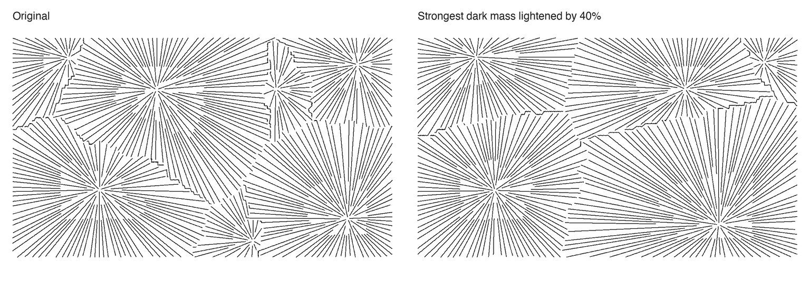

# Notan drainage

This Plotterfun mode traces a painting's light and dark masses. At each sampled position it draws toward the mass with the strongest first-stop score, which combines mass strength, proximity and the connection along the segment. The calculation uses a 4-pixel grid on an image up to 512 pixels on its long side. It exports single-pen centerlines at the source canvas scale.

## Four-edit sunflower

[Download the finished sunflower SVG](sunflower-four-edits.svg). The drawing has 239 pen paths on an 8 × 6 inch page. Masses 2 and 11 were lightened by 40 points, and masses 9 and 17 were darkened by 40 points. The local direction-match scores on the two kept strokes were 49.6% and 31.4%. The exported drawing contains only the pen marks.

## The two prints

[Original SVG](jeong-original.svg) · [Lightened SVG](jeong-lightened.svg) · [Source image](jeong.png)

Jeong Seon, *Clearing after Rain on Mount Inwang*, National Museum of Korea, Seoul. The included PNG preserves the decoded pixels of the public-domain painting fixture used by Russell Parrish / Parallax Metrology. The second drawing moves the strongest dark mass 40% of the way toward white, feathers its edge and reads the edited image again. The edited mass occupied 14.69% of the working image. After matching masses by position and polarity, 66.79% of the 9,472 grid cells changed first destination. The SVGs contain 402 and 349 paths respectively.

## Use the mass editor

Select **Notan drainage** in **Mono**, then click **Load Jeong Seon example**. For another painting, choose **Select image** and **Use image**. Click a shape in the painting or choose it from **Selected mass**. The orange highlight identifies the affected pixels. The two panels show the original and edited drainage drawing with the same tracing settings.

Move **Tone change** left to darken or right to lighten. The number field accepts percentages from −100 to +100. Each mass keeps its own percentage. The editor applies the active changes together to the original painting, using the original mass boundaries. Select an entry under **Active edits** to adjust it again. **Reset mass** removes just that change. **Clear all edits** restores the original drawing. **Download edited SVG** exports the current drawing. To reproduce the two prints above, load the example, leave the default dark mass selected, use spacing 6, black ink, pen width 2 and **Auto Sync** at 96 dpi, then export at 0% and +40%.

## Brush a path

With a source image loaded, choose **Brush a path on this image**, or open **Brush a path** in the mass editor. Draw on the large photo from the start toward the destination. Each search runs in a cancellable worker. Drawing again replaces the stroke.

The tool samples 32 equally spaced segments. It tries up to three original masses near the path, including one near its end, and tone changes of ±20 and ±40 percentage points relative to each current setting. It re-reads each candidate image and evaluates first-stop flow at the same grid cells used for tracing. Direction match averages the positive component of the normalized flow along the stroke. A perfect local alignment scores 100%. It measures local direction along the route, without promising that a single uninterrupted pen line follows it.

A candidate must improve the score by more than half a percentage point. The best qualifying edit is traced and shown beside the original. The source highlights its mass. Orange dots identify samples whose flow is missing or more than 60° away. Hide the guide to inspect the pen drawing alone. **Keep edit** adds the suggestion to the existing mass edits. **Discard preview** restores the current drawing. Candidate marks and guides are excluded from SVG exports.

Choose **Compare a light/dark pair** after the single search. The pair search uses the same stroke, starting edits, nearby masses and 32 direction samples. It tests every combination of one positive and one negative change on different shortlisted masses (up to 24 pairs). Both changes are applied to the same source before the image is read again. Scores are shown even if the pair ties or loses to the best single. Use **Single edit** or **Two edits** to highlight the corresponding masses, then keep your choice or discard the previews.

Keeping a pair retains the first stroke, its unrounded score and its missed samples. Brush a second path through the orange dots, or choose **Trace longest missed section** to follow the longest contiguous run in the original direction. The worker tests ±20 and ±40 points on each previously unedited mass. It only offers an edit if the first stroke meets or exceeds the kept score and the second improves by more than 0.5 percentage points. The preview compares the kept pair with the additional edit. **Discard preview** keeps the pair and its guide.

**Try two new masses on the missed section** reuses the same longest run of orange dots. Starting from the kept drawing, the worker shortlists six unused masses near that run. It tests every pair from that shortlist at −40, −20, +20 and +40 points per mass, including changes in the same direction (up to 240 combinations). Both edits are applied together before scoring. The first-stroke floor uses the unrounded score. The preview reports both stroke scores and how many combinations preserved the first stroke. Discarding a previous single-edit suggestion does not change the baseline.

Keeping a refinement updates the score of every protected stroke to its value in the accepted drawing. **Trace longest missed section** then follows the remaining orange dots on the most recently kept stroke. The worker compares each candidate with every protected score before ranking it on the new section.

The bundled sunflower preview is cropped from the supplied browser screenshot. For full-size analysis use the photo already loaded in Plotterfun, or load the original file.

## Browser benchmark

Open `examples/notan/benchmark.html` under the running app's base URL in the Vite development server and click **Run tracing benchmark**. Keep the page in the foreground. The benchmark traces each prepared field on the main thread and in a dedicated worker. Both use the same integration settings, chunking and two-decimal SVG path serialization. It checks the complete serialized path on every run. Each field has one warm-up per thread and six timed pairs, alternating which thread goes first.

| Drawing | Main elapsed | Worker elapsed | Main timer delay | Worker timer delay |
| --- | ---: | ---: | ---: | ---: |
| Original | 173.5 ms | 180.0 ms | 9.3 ms | 1.2 ms |
| Lightened | 160.5 ms | 166.3 ms | 10.9 ms | 1.4 ms |

Medians from one headless Chrome 157 run on macOS. Elapsed time includes generating and formatting paths and, for the worker, sending the prepared field and receiving the path string. The delay is the median of each run's longest main-thread timer gap in excess of its 8 ms target. This measures scheduling responsiveness. Field preparation, worker startup, SVG insertion, drawing to screen and physical plotting are outside the timed interval. Both exports also matched the reference field and the independently generated paths from the lossless fixture. [Raw timings](benchmark-results.json)

The Notan reader and mass edit come from [Parallax Metrology’s notan-route](https://github.com/parallaxmetrology/notan-route) and the local notan-drainage project. The tracer uses [Andrei Kashcha’s streamlines](https://github.com/anvaka/streamlines). License notices accompany both sources under `src/lib/notan/`. The benchmark investigates the [upstream worker question](https://github.com/anvaka/streamlines/issues/2).
